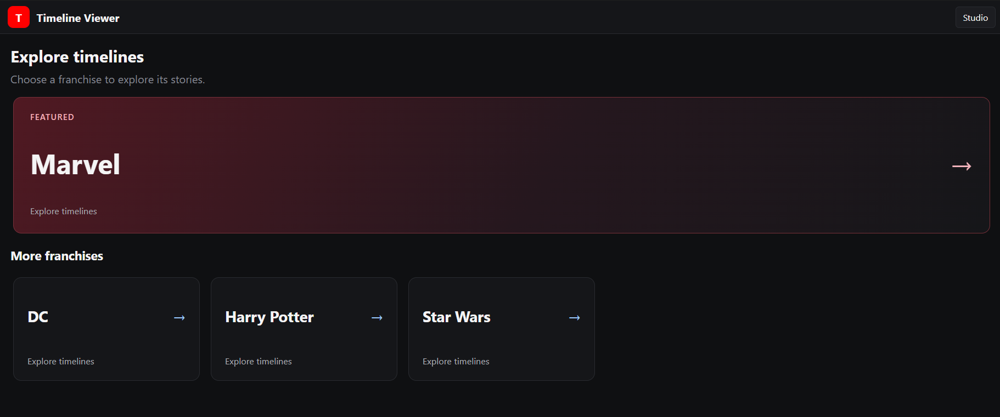
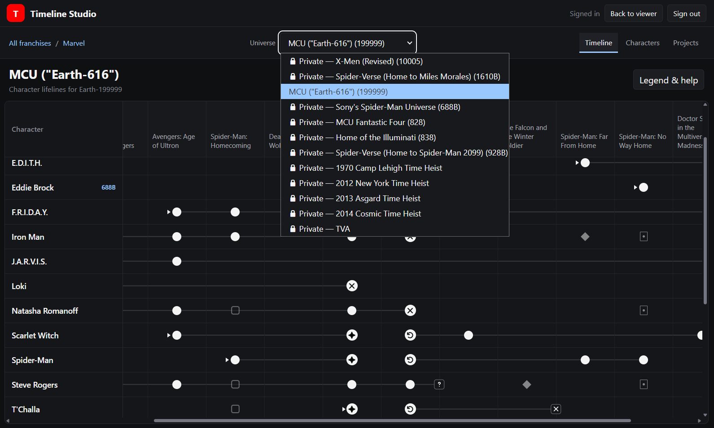

# Fictional-Media Timeline Viewer & Studio

_A personal tool for creating and exploring fictional timelines,
starting with the Marvel Cinematic Universe._

Inspired by an Excel workflow, Timeline Studio uses character rows,
chronological project columns and visual lifelines to track appearances
and events within each universe.

## Current version — `0.5.0`

Shareable timeline links, browser navigation and a featured Marvel entry.
Owner-only Studio editing and selectively published timelines.

See the [development plan](docs/development-plan.md).

> 

> 

## Aim

Make fictional universes easier to explore through timelines, character histories, project details and statistics.

## Screenshots

See the [progress screenshots](docs/images).

## Stack

## Database

Supabase is the source of truth. Files in [docs/supabase](docs/supabase) are
database references, not files the app runs to create its database. They were
refreshed from read-only live metadata on 20 October 2026 and include the
universe-specific entry constraints, publication policies and application functions.
They are reference snapshots rather than complete database backups.

