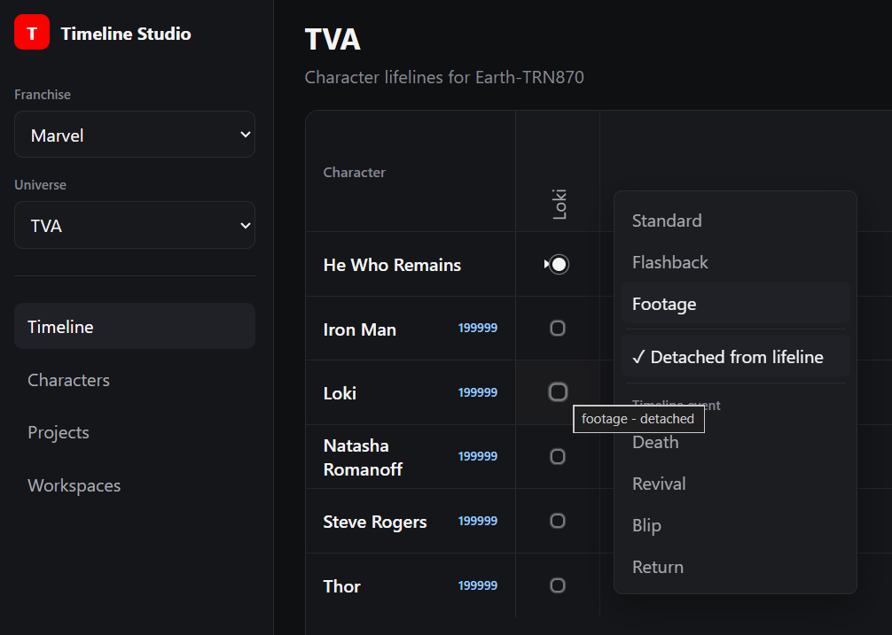
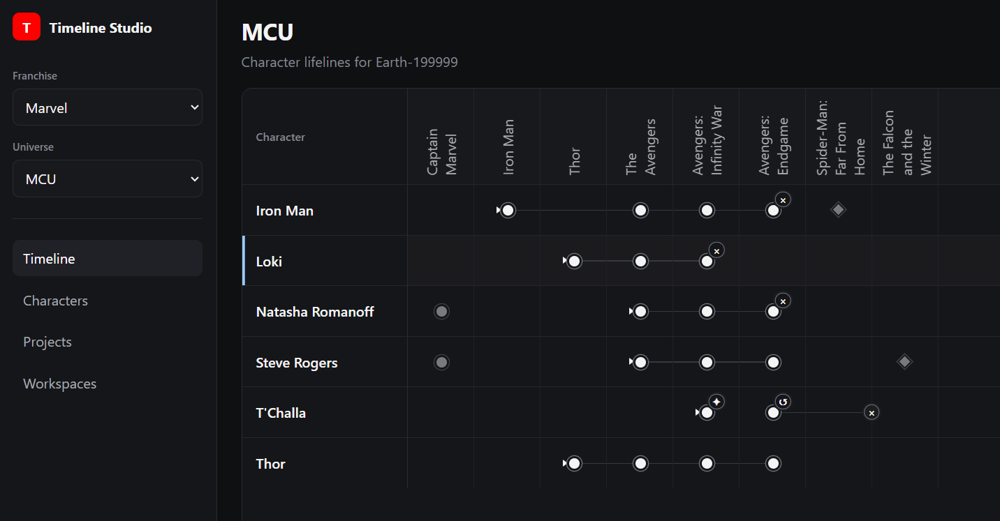

# Fictional-Media Timeline Viewer

_A personal tool for exploring and editing fictional-media timelines,
starting with the Marvel Cinematic Universe._

Inspired by an Excel workflow, Timeline Studio places characters in rows
and projects in chronological columns, with appearance markers and
automatically calculated character lifelines.

## Current version — `0.3.1`

Timeline character origin navigation and focus. Derive timeline rows from character entries.

Characters appear on a timeline when they have an appearance or event in
one of its projects. **Edit on timeline** on the Characters page opens a
temporary row for adding a first entry. Visitor origin labels open the same
character on their origin timeline.

Projects can belong to more than one universe chronology. Their appearances
and events are shared, while project order is specific to each timeline.
See the [development plan](docs/development-plan.md) for current behaviour
and the next passes.

> 

> 

## Aim

To build a feature-packed application showing various film franchise timelines with up-to-date project and character viewers and statistics.

## Screenshots

See the [progress screenshots](docs/images).

## Stack

